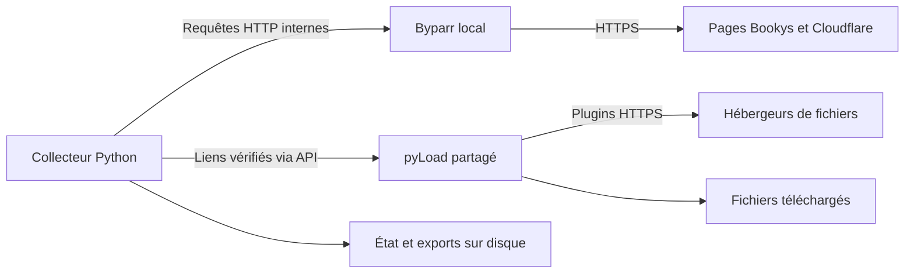

# Architecture Booksys — ADR léger pour revue

Document personnel de revue, en français. État vérifié le 8 novembre 2026.
Il décrit les choix déjà appliqués. Les compteurs de téléchargement restent dans
pyLoad et dans les fichiers d’état ; ils évoluent pendant la lecture.

**Choix principal.** Trois conteneurs tournent sur **booksys-host, `192.0.2.10`** :
un navigateur Byparr, un collecteur Python et l’unique pyLoad existant.
Le système fonctionne sans session Codex ouverte.

**Parcours d’un lien.**

1. Le collecteur lit la [catégorie BD / nouveautés](https://www7.bookys-ebooks.com/bandes-dessinees/new)
   à travers le navigateur Byparr. Ce navigateur traite le challenge Cloudflare.
2. Il ouvre chaque fiche, puis ses pages intermédiaires `/dl/<id>`.
3. Il extrait toutes les adresses d’hébergeurs présentes dans la structure reconnue.
   Aucun filtre ne limite la collecte à 1fichier ou Nitroflare.
4. Il crée un paquet par fiche dans pyLoad. Ce paquet contient tous ses liens distincts.
   Il vérifie les liens par l’API, puis confirme le passage dans la file de téléchargement.
5. pyLoad contacte les hébergeurs avec ses plugins. Il gère les attentes et les transferts.
   Byparr intervient sur Bookys ; il ne résout pas les captchas des hébergeurs pour pyLoad.

Une fiche locale `fiche.md` conserve désormais le résumé et les informations
fournies par Bookys dans chaque dossier de paquet. Sa couverture est enregistrée
localement. Le référentiel central `catalogue.yaml` expose ces métadonnées,
les chemins associés et un instantané daté des états pyLoad pour un LLM.
Ces documents restent utilisables si Bookys disparaît. Le rattrapage des
200 fiches tourne pendant les pauses du collecteur, sans nouvel envoi à pyLoad.

**Pourquoi ces choix ?**

| Choix | Motif | Compromis |
| --- | --- | --- |
| Byparr local | Réutiliser un navigateur existant pour Cloudflare ; respecter ton refus d’un service distant | Consommation CPU/RAM et collecte lente ; les changements du site peuvent bloquer le parcours |
| Garder pyLoad-ng | Réutiliser l’instance, sa file et ses plugins ; aucun gain mesuré ne justifie une migration | Certains plugins échouent ; JDownloader reste une option à comparer si ces échecs deviennent bloquants |
| Un seul pyLoad pour Lunii et Booksys | Ton choix explicite | File, configuration et maintenance partagées |
| Envoyer tous les hébergeurs | Ton choix explicite ; conserver plusieurs sources | Certains liens échouent ; plusieurs miroirs peuvent télécharger le même contenu |
| Conserver l’état hors des conteneurs | Reprendre après interruption et éviter les renvois aveugles | L’état du collecteur et la base pyLoad doivent être conservés ensemble |

**Automatisation.** Le lot initial porte sur les dix pages les plus récentes.
Après ce lot, le collecteur cherche les fiches dont l’identifiant dépasse son
repère enregistré. Il attend **15 minutes après chaque cycle**. Le délai réel
entre deux passages inclut donc la durée du cycle. Une ancienne fiche modifiée
sans nouvel identifiant n’est pas détectée comme une nouveauté.

Chaque envoi est enregistré avant l’appel API. Un nom de paquet stable permet
la recherche du résultat après une réponse perdue. Si le résultat reste incertain,
le cycle s’arrête sans recréer aveuglément le paquet.

pyLoad relance les liens échoués toutes les **90 minutes** avec son module natif
`RestartFailed`. Les attentes des hébergeurs suivent leur propre compteur.
Les conteneurs utilisent `unless-stopped` : ils redémarrent après un arrêt Docker,
sauf s’ils ont été arrêtés manuellement.

**Accès et données.**

| Ressource | Adresse ou emplacement |
| --- | --- |
| Interface pyLoad | [http://192.0.2.10:8000](http://192.0.2.10:8000) |
| API pyLoad vue du collecteur | `http://pyload:8000/api`, réseau Docker interne |
| API Byparr vue du collecteur | `http://byparr:8191/v1`, sans port publié sur la VM |
| Tous les liens extraits | `/opt/booksys/state/all-links.txt` |
| Référentiel central pour LLM | `/opt/booksys/state/catalogue.yaml` |
| Fiche locale par paquet | `/opt/booksys/downloads/<dossier>/fiche.md` |
| Couverture locale | `/opt/booksys/downloads/<dossier>/couverture.<extension>` |
| Exports par hébergeur | `/opt/booksys/state/<hoster>.txt` |
| Fiches, repère et journal des envois | `/opt/booksys/state/` |
| Fichiers téléchargés | `/opt/booksys/downloads/` |
| Configuration et base pyLoad conservées | `/opt/related-project/lunii/.pyload/config/` |
| Secret API, privé | `/opt/booksys/secrets/pyload.json`, permissions 0600 |

Les trois services partagent `booksys_default`. Le fichier `compose.runtime.yaml`
gère Byparr et le collecteur. `compose.shared.yaml` gère pyLoad.
L’ancien second pyLoad sur le port 8001 a été retiré. Le port 8000 conserve son
écoute sur toutes les interfaces de la VM. Aucune nouvelle route publique n’a été créée.

**Limites connues.** Les délais gratuits, liens morts, restrictions premium et
captchas non pris en charge peuvent empêcher un téléchargement. Aucun compte
premium/debrid ni service payant de captcha n’a été ajouté. L’option qui ignore
les fichiers existants reste active ; l’identité du contenu entre miroirs n’est
pas vérifiée. « Envoyé », « en attente », « ignoré » et « terminé » sont des états
différents. Un lien marqué terminé ne prouve pas l’intégrité de l’archive.

Une réserve de **20 Gio** limite les nouveaux envois et les téléchargements.
Le debug est désactivé. Un filtre Python impose **WARNING et au-dessus**, car
cette version de pyLoad ne propose nativement que DEBUG ou INFO. Les journaux
Docker tournent sur **5 fichiers de 20 Mio**. Les fichiers de logs pyLoad gardent
leur rotation native. Des copies de récupération existent ; une sauvegarde
récurrente et une restauration complète n’ont pas été validées. Les images sont
figées. Les mises à jour sont manuelles. Git reste local. Aucune alerte externe
n’est configurée pour les échecs de collecte ou de téléchargement.

Pour lire l’état actuel : `uv run python ops/status.py`.
Détails : [architecture](../architecture.md) et exploitation, en anglais.
