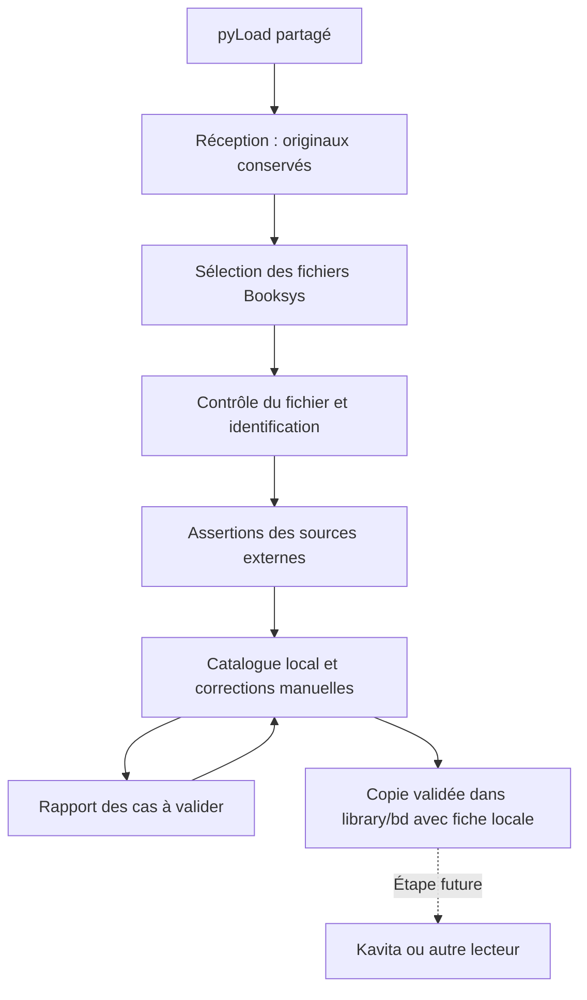

# Bibliothèque BD locale et enrichissement — spec V1

Current operating scope: BETA/LAB.
The lab uses retained originals and journaled recovery, without an external
backup or extra account/deployment/GO. Production prerequisites are separate.

Document personnel de revue, en français. Date : 8 novembre 2026.
Statut : validé par the operator le 8 novembre 2026 après revue critique Claude.
Les choix ci-dessous proviennent du grilling. Ce document décrit une cible,
pas le runtime actuel. Les portes techniques restent à qualifier.
Livrable de cette session : conception et revue Claude. Aucune conversion de fichiers.
Suite d'exécution : tâches V1,
epic Beads `private-work-item`. La création du suivi ne lance pas l'implémentation.

## Résultat attendu

Créer une bibliothèque BD locale qui reste utilisable sans Bookys ni lecteur donné.
Conserver une fiche par ouvrage et distinguer ses éditions et ses variantes.
Préparer une future utilisation dans Kavita ou un équivalent.
Kavita et sa synchronisation restent hors V1.
Amendement validé par the operator le 8 novembre 2026 : la bibliothèque convertit les
copies CBR en CBZ et écrit ComicInfo.xml dans toutes ses copies CBZ.
All published comic copies are CBZ, including PDF sources. Originals remain intact.

## Décisions confirmées

| Sujet | Règle V1 |
| --- | --- |
| Référentiel | Le catalogue local conserve les métadonnées validées. Le lecteur reste remplaçable. |
| Unité | Une fiche représente un album ou un tome. Une intégrale publiée reste un ouvrage distinct. |
| Éditions | Des éditions justifiées par des données restent distinctes sous le même ouvrage. |
| Variantes | Des scans ou formats différents restent distincts. Une seule variante est exposée par défaut pour chaque édition. |
| Doublons | Des fichiers strictement identiques occupent une seule place dans la bibliothèque. Toutes leurs origines restent traçables. |
| Originaux | Les fichiers de réception restent intacts. La bibliothèque utilise des copies indépendantes. |
| Périmètre | Fichiers individuels PDF, CBZ et CBR, déjà reçus ou futurs, provenant de Booksys. |
| Exclusions | Lunii, fichiers partiels, formats non pris en charge et lots à décomposer. |
| Admission | Automatique si l'identité de l'ouvrage et de l'édition est suffisamment prouvée. Sinon, validation manuelle. |
| Métadonnées | Valeurs explicites provenant des sources ou de corrections manuelles. Aucun classement par LLM. |
| Corrections | Une correction manuelle reste prioritaire, champ par champ. |
| Revue | Rapport local et décisions par lots dans la conversation. Pas d'interface dédiée en V1. |
| Destination | `/data/booksys/library/bd/`. |
| Fiches | Catalogue central, fiche et couverture locale ; ComicInfo.xml dans les copies CBZ. |
| Archives publiées | CBZ uniquement. Conversion of CBR and PDF copies; ComicInfo from the validated catalogue. |

## Modèle et propriété des données

Le [glossaire](../../GLOSSARY.md) définit les termes.
Une série regroupe des ouvrages. Un ouvrage regroupe ses éditions.
Une édition regroupe ses variantes. Une variante référence ses fichiers.
Une fiche Bookys et un paquet pyLoad restent des origines, pas des identifiants d'ouvrage.
Une origine peut décrire plusieurs ouvrages. Un ouvrage peut avoir plusieurs origines.
En V1, une variante admissible contient exactement un fichier complet.
Une empreinte peut avoir plusieurs origines mais une seule attribution validée
à une variante et à son édition. Deux revendications contradictoires bloquent
l'admission. L'égalité des octets ne fusionne jamais les identités bibliographiques.

Conserver les données capturées dans `state.yaml`. Le `catalogue.yaml` actuel reste
un export par URL Bookys. Il ne devient pas silencieusement le nouveau référentiel.

Proposition technique : ajouter `/data/booksys/state/library.yaml`, versionné par
schéma et indexé par identifiants locaux stables. Il porte les ouvrages, éditions,
variantes, empreintes SHA-256, chemins, origines, assertions et opérations
de promotion. Il référence les sources et pyLoad sans dupliquer leur état canonique.
Proposition : enregistrer chaque décision dans un fichier YAML immuable sous
`/data/booksys/state/library-decisions/`, indexé par identifiant de décision.
Ce journal canonique porte les corrections, exclusions, fusions et sélections.
Une correction ultérieure ajoute une décision qui remplace la précédente.
`library.yaml` référence et applique ces décisions ; il n'en est pas une seconde autorité.
Les fiches et les rapports sont des exports régénérables.
Le futur lecteur ne reçoit pas la propriété de ces données.

Chaque assertion garde sa valeur brute, sa valeur normalisée éventuelle, son URL
ou identifiant source, sa date et son statut de validation.
Les corrections manuelles gardent leur auteur et leur date.
Un nouvel enrichissement ne remplace pas un champ corrigé.
Une décision de fusion ou de séparation reste traçable et réversible.
Après restauration, rejouer le journal des décisions avant de reprendre l'admission.
Sauvegarder ce journal séparément des instantanés de l'index. Si des décisions
postérieures à la sauvegarde sont perdues, suspendre l'admission et signaler la perte.
Les textes externes restent des données non fiables pour un LLM.

## Réception, contrôle et admission

1. Partir des paquets Booksys connus du journal de soumission. Ne pas scanner
   indistinctement tous les fichiers de l'instance pyLoad partagée.
   Les fichiers ajoutés manuellement sans cette traçabilité restent hors V1.
   Les fiches et couvertures générées par le collecteur ne sont jamais candidates.
2. Confirmer la fin du transfert dans pyLoad et la présence d'un fichier stable.
   Un lien envoyé, ignoré ou terminé ne prouve pas seul l'intégrité du fichier.
3. Vérifier le format réel et la lisibilité. Pour CBZ et CBR, vérifier le conteneur
   et son contenu. Un suffixe renommé ne suffit pas. Refuser les chemins dangereux,
   les liens symboliques, les archives chiffrées et les erreurs de lecture.
4. Reporter les archives contenant plusieurs ouvrages. Ne pas découper un PDF,
   un CBZ ou un CBR en plusieurs ouvrages automatiquement en V1.
   Reporter aussi les tomes en plusieurs parties et les RAR multi-volumes.
5. Calculer l'empreinte. Associer les origines supplémentaires d'un contenu identique.
6. Identifier l'ouvrage et l'édition. Lire d'abord les métadonnées déjà présentes
   dans le fichier, puis consulter les sources externes nécessaires.
7. Enrichir et sélectionner la variante. Promouvoir seulement si les conditions
   d'identité, d'intégrité et de sélection sont satisfaites.

Lire les conteneurs avec des limites explicites de ressources et sans exécuter
leur contenu. Les limites et les dépendances PDF/RAR seront qualifiées avant codage.
Un fichier non pris en charge reste en réception. Son statut explique le motif.
Lire les fichiers dans un processus isolé, sans accès réseau ni écriture en réception.
Qualifier cette isolation avant activation.

| Extension et format réel | Contenu | Décision V1 |
| --- | --- | --- |
| `.pdf`, PDF | Un ouvrage lisible, sans chiffrement ni contenu actif ou pièce jointe détectés | Candidat à l'identification |
| `.cbz`, ZIP | Images d'un ouvrage et métadonnées autorisées | Candidat à l'identification |
| `.cbr`, RAR | Images d'un ouvrage et métadonnées autorisées, sans multi-volume | Candidat à l'identification |
| Archive contenant d'autres archives, PDF ou plusieurs ouvrages | Lot ou structure imbriquée | Attente hors périmètre |
| Ensemble en plusieurs parties | Représentation incomplète par fichier | Attente hors périmètre |
| Extension et format réel différents ; `.zip` ou `.rar` génériques | Format ambigu ou hors liste | Attente ; aucune correction automatique |
| Chiffrement, contenu dangereux, corruption ou contenu non autorisé | Tout format | Aucune admission |
| Autre cas | Tout format | Non pris en charge |

La liste des métadonnées autorisées et les moyens de détection PDF restent à
qualifier. En cas de résultat non déterminé, ne pas admettre le fichier.
L'identification porte sur chaque fichier. Une fiche Bookys multi-ouvrages ne
transmet jamais automatiquement la même identité à tous les fichiers de son paquet.

## Identification et enrichissement

Le titre seul ne permet pas une admission automatique.
Un identifiant bibliographique exact, cohérent avec les autres données, est une
preuve possible. Sinon, plusieurs éléments indépendants doivent concorder : auteur,
tome, titre, éditeur, langue, date ou couverture. Une contradiction significative
impose une revue. Un score fourni par un outil ne constitue pas une preuve à lui seul.
L'identification automatique reste déterministe, sans LLM. Les noms de fichiers
et les pages Bookys donnent des indices, pas une preuve suffisante.
Des assertions dérivées de la même source amont ne comptent qu'une fois.
La porte de validation exige zéro admission automatique erronée sur un échantillon
étiqueté comprenant titres proches, intégrales, hors-séries et éditions concurrentes.
Ce résultat ne garantit pas l'absence d'erreur sur tout le corpus.
Un conflit de langue, d'éditeur ou de contenu révisé qui empêche de distinguer
l'édition bloque la promotion ; il ne reste pas un simple champ facultatif en conflit.

Le seuil exact reste une porte de validation avant activation : définir les règles
sur un échantillon représentatif, avec faux titres proches, intégrales et éditions.
Si les données ne justifient pas l'édition, l'enregistrement reste provisoire.
Ne pas inventer une édition pour pouvoir publier.
En V1, une édition indéterminée bloque la promotion, même si l'ouvrage est connu.
Ce choix limite la couverture automatique des scans sans données d'édition.
La revue manuelle peut confirmer une édition avec ses preuves ou différer le cas.

Sources candidates : métadonnées embarquées, Bédéthèque, BDTheque et sources manga.
[MetaKavita](https://github.com/raukorim-bot/MetaKavita) est le premier candidat à
évaluer pour réutiliser les connecteurs. Ce choix n'est pas une dépendance validée.
Leur accès, leur licence, leurs champs et leur comportement sur nos titres restent
à vérifier. Aucune installation de Kavita n'est nécessaire à la conception.

Séparer la catégorie Bookys, les genres et le public indiqué.
Conserver la valeur exacte de public et la source. « Adulte » ne prouve pas le
genre « érotique ». Ne pas déduire le genre du nom de l'auteur.
Un champ absent reste inconnu. Un genre inconnu ne bloque pas un ouvrage identifié.
Les valeurs contradictoires restent visibles. Ne pas traiter un défaut d'API comme
une réponse « tout public ». Mettre en cache les réponses et limiter les requêtes.
Une contradiction d'identité apparue après admission marque le cas « contesté »
et ouvre une revue. Elle ne retire ni ne remplace automatiquement le fichier exposé.
Une décision manuelle antérieure reste prioritaire ; la nouvelle assertion reste visible.

## Copies et variantes

Reception formats remain PDF, CBZ and CBR. Every published copy is CBZ with
ComicInfo.xml from the validated catalogue. This amendment was confirmed by
the operator on 8 November 2026. Original PDF bytes remain untouched.

For PDF pages, extract an embedded image only when it demonstrably represents
the complete visible page, with matching geometry and no unresolved rotation,
colour, transparency or annotation effect. Otherwise render the visible CropBox
with qualified Poppler at 200 dpi. Rendering preserves the visible page order and
appearance; it loses searchable text, vector structure, links and editability.
Record extraction or rendering per page, geometry, resolution, tool versions,
source hash, output page hashes and artifact hash. Do not call rasterization
lossless. Keep the same resource bounds and reject active or ambiguous input.
Conversion does not establish bibliographic identity. Unknown editions remain pending.
Les images des CBR et CBZ conservent leurs octets, noms et ordre de lecture.
Vérifier le nombre de pages et leurs empreintes avant et après transformation.
Un ordre ambigu impose une attente. Ne pas réencoder les images.
Conserver les métadonnées sources comme assertions avec leur provenance.
Un ComicInfo source en conflit ne remplace jamais une valeur validée ou corrigée.
Valider le XML généré contre le schéma ComicInfo qualifié et relire le CBZ produit.
L'empreinte de l'asset source et celle de l'artefact publié peuvent différer.
Journaliser la transformation, sa version, le manifeste des pages et les deux
empreintes. Dédupliquer les sources identiques et les artefacts générés séparément.
Cette déduplication ne fusionne jamais deux éditions.

L'exposition au lecteur se limite à `/data/booksys/library/bd/`.
Ne pas exposer la réception ni le répertoire d'état.
Proposition de rangement : un dossier par édition, avec identifiants stables et
noms lisibles. Fixer la convention exacte après validation sur le futur lecteur.
Toute réorganisation ultérieure sera journalisée, avec reprise et retour arrière.
Chaque dossier exposé contient le fichier sélectionné, `fiche.md` et sa couverture
locale disponible. La fiche reste compréhensible si le site source disparaît.

Préparer le dossier complet hors de l'arbre exposé, sur le même système de fichiers.
Le nom temporaire référence une opération durable. Vérifier l'asset source contre
son empreinte identifiée. PDF output is verified as a transformed CBZ, not a byte-identical PDF copy.
Pour un CBZ généré, vérifier les images, l'ordre et le XML puis son empreinte propre.
Un changement de contenu impose un nouvel examen. Publier le dossier complet
atomiquement, avec interdiction d'écraser une destination existante.
Synchroniser les fichiers et les répertoires sur disque avant validation finale.

Le journal porte ces étapes : intention, préparation, vérification, publication,
validation du catalogue. Une intention précède toute copie. La fiche et le fichier
sont prêts avant publication ; une couverture absente est signalée dans la fiche.
Un journal non validé interdit d'annoncer le cas comme publié.
Après interruption, le journal décrit l'intention ; le disque et les empreintes
prouvent le résultat. La reprise les réconcilie avant toute nouvelle publication.
En cas de divergence non expliquée, bloquer l'opération et conserver les preuves.
Enregistrer l'empreinte de l'asset et celle de la copie publiée séparément.
Une copie modifiée hors gestion est signalée. Aucune republication, suppression
ou correction automatique ne touche ce chemin tant que le cas n'est pas résolu.

La création initiale interdit tout écrasement. Les modifications ultérieures sont
des opérations distinctes, journalisées : fiche, couverture, sélection ou retrait.
Avant toute modification, vérifier la version du catalogue et les empreintes
publiées de tous les fichiers gérés, y compris fiche et couverture.
Une dérive sur l'un de ces fichiers bloque la régénération automatique.
Préparer le dossier de remplacement complet hors exposition, puis substituer
atomiquement l'ancien et le nouveau dossier gérés. Ne jamais appliquer une
substitution à une destination inconnue ou à une version différente.
Le mécanisme de substitution et sa résistance au crash sont une porte de validation.
Cette porte couvre aussi une modification externe entre le contrôle et la substitution.
L'ancien dossier rejoint un emplacement de récupération hors de l'arbre exposé.
Le conserver jusqu'à validation du catalogue et jusqu'au terme du retour arrière
prévu par le plan d'opération. La V1 ne purge pas automatiquement ces révisions.
Un retrait décidé par the operator est aussi journalisé et conserve le dossier hors
exposition pour le retour arrière. La rétention compte dans l'estimation de capacité.
Une mise à jour expose l'ancien ou le nouveau dossier complet, jamais leur mélange.

Les variantes non sélectionnées restent conservées dans la réception et référencées
dans le catalogue. La V1 ne promet pas une sauvegarde indépendante de ces variantes.
Un choix incertain attend une décision. La taille seule ne prouve pas la qualité.
Ne pas remplacer automatiquement une variante déjà sélectionnée par un nouveau scan.
Le changement de sélection doit préserver l'ancienne origine et permettre le retour.
Avant usage, retrouver chaque origine par ses identifiants pyLoad, son chemin
et son empreinte. Un chemin seul ne suffit pas. Vérifier présence et contenu.
Ne jamais retirer une copie existante avant d'avoir une copie de retour vérifiée.
Une origine disparue reste dans le catalogue avec un statut explicite.
Le composant bibliothèque ne modifie jamais les fichiers de réception.
Il utilise une vue de la réception en lecture seule. Le collecteur existant garde
ses propres écritures de fiches. Qualifier cette séparation avant activation.
Auditer les plugins pyLoad d'extraction, suppression et renommage avant le rattrapage.
La permanence des originaux dépend aussi de ces réglages et des actions de l'opérateur.

## Rapport et corrections

Chaque cas possède un identifiant stable, ses fichiers, ses origines, les candidats,
les preuves disponibles et le motif du doute. Le rapport distingue identité incertaine,
édition incertaine, conflit de métadonnées, variante à choisir et fichier rejeté.
the operator peut accepter, corriger, différer ou exclure un cas par son identifiant.
L'enregistrement vérifie que le cas n'a pas changé depuis le rapport.
Chaque proposition porte une version liée à ses entrées. Une décision ne s'applique
que si cette version correspond. Un lot rend un résultat par cas : appliqué, périmé
ou rejeté. Les cas périmés ne reçoivent pas de décision silencieuse.
Seule une instruction de the operator désignant les cas autorise leur validation.
Délimiter et échapper les textes externes. Ils ne peuvent produire de décision,
de commande ou d'identité, même lorsqu'un agent transcrit la réponse de the operator.
Les décisions portent aussi les identifiants stables des entités et empreintes visées,
pour rester rejouables après régénération des rapports.
La conversation seule ne constitue pas une décision durable : écrire la décision
structurée avant de régénérer la fiche et de rendre le cas admissible.
Ne pas modifier les fiches générées à la main.

## Échecs, capacité et reprise

L'enrichissement ne bloque pas le collecteur ni les téléchargements pyLoad.
L'état bibliothèque et son journal ont leurs propres verrous. Aucun appel réseau,
hachage ou copie lourde ne s'exécute sous le verrou du collecteur ni sous un verrou
de modification des métadonnées. Lire un instantané puis vérifier sa version lors
de la courte écriture. La coordination exacte sera testée avec le collecteur actif.
Un échec de source conserve les données déjà acquises et reporte sa tentative.
Il ne dégrade pas une valeur validée. Une erreur locale d'intégrité ou une identité
incertaine bloque la promotion du seul cas concerné.

Avant les copies, vérifier capacité, permissions, chemins et état de sauvegarde.
Maintenir la réserve existante de 20 Gio. Réserver aussi la taille de la copie
temporaire pour ne pas franchir cette limite. La coordination de cette réservation
avec pyLoad est une porte technique à qualifier avant activation.
Ne pas supposer qu'un contrôle ponctuel empêche un remplissage concurrent.
Limiter la promotion à une copie active. Contrôler l'espace pendant la copie,
puis après préparation et avant publication. En cas de franchissement de réserve,
abandonner la promotion et nettoyer uniquement son temporaire identifié.
Si la coordination ne protège pas la réserve pendant l'activité pyLoad, suspendre
la promotion jusqu'à une fenêtre compatible ; ne pas modifier la file pyLoad.
Interrompre la promotion en cas de manque de place. Ne pas nettoyer les originaux.

La reprise et le retour arrière doivent être testés dans un répertoire isolé.
Restaurer catalogue et journal cohérents, puis réconcilier les copies gérées.
Ne supprimer que les sorties gérées attribuées à l'opération, après vérification
de leur empreinte et autorisation applicable. Ne jamais utiliser une purge globale.
Conserver les preuves et les sauvegardes nécessaires au retour arrière.

## Preuves d'acceptation

| Cas | Résultat exigé |
| --- | --- |
| Paquet Lunii et format non pris en charge | Aucune admission dans la bibliothèque BD. Motif explicite. |
| Fichier partiel, corrompu ou extension trompeuse | Aucune admission. Aucun original modifié. |
| Même contenu depuis deux miroirs | Un seul fichier exposé. Deux origines conservées. |
| Même tome, éditions différentes | Éditions distinctes si prouvées ; sinon attente. |
| Deux scans de la même édition | Variantes conservées. Une seule sélection exposée. |
| Lot de plusieurs tomes | Attente explicite, sans extraction automatique. |
| Identité prouvée, genre absent | Admission possible, genre inconnu. |
| Titre ambigu ou sources contradictoires | Attente ou champ en conflit selon la portée du doute. |
| Correction manuelle puis nouvel enrichissement | Correction intacte ; nouvelles assertions traçables. |
| Source indisponible | Données validées intactes. Collecte et pyLoad indépendants. |
| Interruption pendant copie ou publication | Reprise cohérente, sans doublon final ni catalogue mensonger. |
| Modification de la copie de bibliothèque | Empreinte de l'original inchangée. |
| Espace insuffisant ou chemin non géré | Aucune écriture finale ni nettoyage des originaux. |
| Perte d'accès à Bookys et aux sources | Fiches, métadonnées et liens locaux restent lisibles. |
| Un asset revendiqué par deux éditions ou ouvrages | Conflit visible, aucune nouvelle attribution automatique. |
| Tome en plusieurs PDF ou RAR multi-volumes | Attente hors V1. Aucune partie publiée seule. |
| Fichier remplacé entre identification et copie | Empreinte différente, aucune publication. |
| Origine renommée ou supprimée | Statut explicite. Aucun changement de sélection sans retour vérifié. |
| Crash à chaque transition du journal | Dossier exposé complet ou absent. Réconciliation avant reprise. |
| Crash pendant une mise à jour | Ancien ou nouveau dossier complet, sans mélange ; retour conservé hors exposition. |
| Fiche ou couverture modifiée hors gestion | Dérive visible ; aucune régénération automatique sur ce dossier. |
| Restauration d'un index ancien | Décisions rejouées avant reprise ; perte de journal signalée et bloquante. |
| Lot contenant des propositions périmées | Résultat par cas. Aucune décision appliquée à une version différente. |
| Texte externe demandant une validation | Aucune décision produite par ce texte. |
| Plusieurs sources dérivées d'une seule origine | Une seule preuve amont comptée. |
| Contradiction après admission | Cas contesté visible ; aucun retrait automatique. |
| Copie publiée modifiée hors gestion | Dérive signalée ; chemin protégé contre réécriture ou suppression. |
| Saturation concurrente avec pyLoad | Arrêt des copies, respect de la réserve dans l'enveloppe qualifiée. |
| CBR solid converti en copie CBZ | Même nombre, noms, ordre et empreintes des images ; source inchangée. |
| CBZ avec ComicInfo contradictoire | XML régénéré depuis le catalogue validé ; assertions sources conservées. |
| Transformation interrompue | Aucun artefact partiel exposé ; reprise journalisée sans perte des originaux. |
| PDF after promotion | CBZ, one visible page per ordered image; extraction/render method and hashes recorded; original unchanged. |
| Enrichissement lent pendant un cycle de collecte | Aucun verrou long ne bloque le collecteur. |

Les essais isolés comparent un inventaire haché complet de la réception de test
avant et après traitement. Sur le runtime partagé, comparer les fichiers concernés
sans confondre les transferts pyLoad concurrents avec une modification par la bibliothèque.

## Portes avant implémentation et activation

the operator a confirmé cette compréhension commune après la revue Claude.
L'implémentation doit qualifier le schéma YAML, les règles d'identité, les limites
des lecteurs de fichiers et les connecteurs. Aucun fournisseur n'est déjà validé.
L'activation sur les fichiers existants exige un plan d'opération avec inventaire,
estimation de capacité, sauvegarde, commandes versionnées, preuves et retour arrière.
Le rattrapage historique n'est pas lancé par la livraison de cette spec.
Le futur lecteur aura sa propre validation de rangement et d'import des métadonnées.

## Accepted BETA/LAB operation amendment — 8 November 2026

the operator confirmed a five-minute automatic library cycle and a read-only LAN page.
The cycle selects new finished tracked Booksys inputs without manual asset lists.
It reuses unchanged validated origins and all existing identity/publication gates.
One nonblocking lock prevents overlap and duplicates. Each cycle validates at
most eight new/changed inputs, processes at most eight assets and shares at most
50 provider requests. Unfinished inputs and Lunii are excluded from processing.
Temporary failures allow three attempts with 300/900-second delays. Successful
uncertain identity is terminal pending; budget deferral spends no attempt.
Save progress and expose backlog and interrupted/failed outcomes. Preserve sources.

Expose an escaped compact read-only LAN table with filters, refresh, status,
transfer, intake, OCR, identity, publication, reason and fiche links. Show snapshot
age, cycle start/end/duration and next run. The page is saved state, not live
pyLoad. GET/HEAD only; no raw private evidence or hoster links and no write routes.
Use the existing YAML sources and stdlib tools, without another database/framework.

The table supports per-stage filters, title/author/ISBN/series/reason search and
column sorting. Every origin has a bounded fiche, including pending inputs.
Expose collected bibliography, summary, genres/audience, candidates and source
assertions with dates and qualified bibliographic links. Show unknowns and
blockers. Label a local cover as the first file page, not a publisher image.
Collapse technical details. Do not query new providers to render a fiche.

Descriptions preserve manual corrections, then use the matching captured Bookys
page, then available bibliographic text. Show the selected provenance. Strip
source HTML to bounded text and show explicit absence when no description exists.
